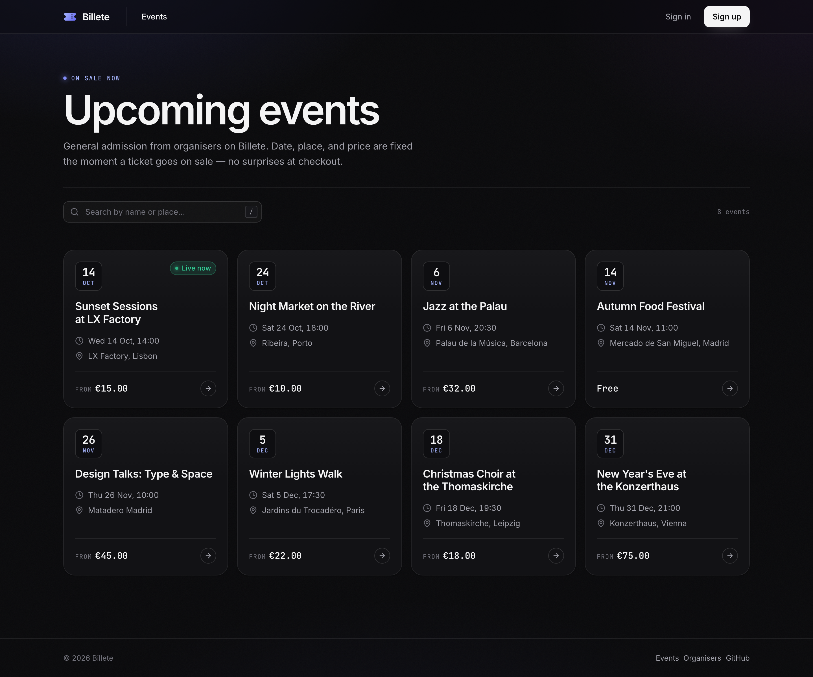

# Billete

[](https://github.com/Roughosing/billete/actions/workflows/ci.yml)
[](https://www.ruby-lang.org/)
[](https://rubyonrails.org/)

Billete sells general-admission tickets. An organiser publishes an event with a date, a place, and a price, and those stay fixed once the event is on sale. Anyone can browse what is coming up; signed-in organisers run their events from a dashboard.

Checkout is the next piece of work. The event page shows ticket types and remaining places, and the purchase button stays disabled until payments are wired up.



## Features

- Public marketplace of upcoming events, with search by name or place
- Event pages with the schedule, location, description, and each ticket type
- Accounts: sign up, sign in, password reset, profile, email change, and account deletion
- Organisations with an admin and a staff role. Admins can rename the organisation; staff can create events
- Event creation with a general-admission ticket type, a price, and a capacity
- Organiser dashboard with upcoming events, tickets issued, and capacity sold
- Ticket inventory enforced in PostgreSQL, including a row lock so two buyers cannot take the last place

## Stack

- Ruby 3.3.6 and Rails 8.1
- PostgreSQL
- Server-rendered views with Hotwire (Turbo and Stimulus)
- Propshaft and import maps, with no JavaScript build step
- Solid Cache and Solid Queue, both backed by PostgreSQL
- Authentication with `has_secure_password` and a signed session cookie

## Requirements

- Ruby 3.3.6 (see `.ruby-version`)
- PostgreSQL running locally. CI uses PostgreSQL 17
- Bundler

## Getting started

Install gems, create the databases, and start the server:

```bash
bin/setup
```

`bin/setup` is safe to run again. It prepares `billete_development` and `billete_test`, then starts the app at [http://localhost:3000](http://localhost:3000).

To prepare the app without starting the server:

```bash
bin/setup --skip-server
bin/dev
```

`bin/dev` is the Rails server. There is no separate asset process to run.

Sign up from the site to create an account, then use **Dashboard** to create an organisation and an event. The event is listed on the marketplace as soon as it is saved.

## Tests and checks

```bash
bin/rails test
bin/rails test:system
bin/rubocop
bin/brakeman --quiet --no-pager
```

`bin/ci` runs the same checks as GitHub Actions: RuboCop, Bundler audit, the import map audit, Brakeman, the test suite, and a seed load.

Pull requests and pushes to `main` run [`.github/workflows/ci.yml`](.github/workflows/ci.yml):

- **test** — Rails test suite, then seeds
- **system-test** — system tests, with screenshots saved when a run fails
- **lint** — RuboCop
- **scan_ruby** — Brakeman and Bundler audit
- **scan_js** — import map vulnerability audit
- **Docker image** — production image build, then a boot check against Postgres

## Production image

The Dockerfile builds a production image. It expects the Rails master key and a Postgres instance:

```bash
docker build -t billete .
docker run -d -p 80:80 -e RAILS_MASTER_KEY=<value from config/master.key> --name billete billete
```

`config/master.key` is not in git. In production the database connection is read from `DB_HOST`, `DB_USERNAME`, and `DB_PASSWORD`.

## Project layout

| Path | What lives there |
| --- | --- |
| `app/models` | Users, organisations, events, ticket types, and tickets |
| `app/controllers` | Marketplace, organiser dashboard, account settings |
| `app/views` | Server-rendered pages |
| `app/assets/stylesheets` | Design tokens, components, and page styles. `application.css` lists the load order |
| `app/assets/images/icons` | Inline SVG icons |
| `app/javascript/controllers` | Stimulus: account menu, toasts, marketplace search |
| `db/migrate` | Schema, including the constraints that protect ticket inventory |

## License

No license is included. All rights reserved.
